# Go Backend Academy — Curriculum Dependency Graph (`DEPENDENCY_GRAPH.md`)

**Audit Date:** 2026-11-07
**Purpose:** Machine-verifiable DAG (Directed Acyclic Graph) of the current curriculum gaps vs the reconstructed Zero-to-Production Learning Progression (`Stages A → J`).

---

## 1. Audit of Current Curriculum Dependency State

In the existing codebase (`internal/modules/lessons/service.go`, `migrations/*/001_initial_schema.up.sql`, and `web/index.html`):
1. **No `prerequisites` field exists** on `shared.LessonSummary`, the `lessons` SQL table, or `PLATFORM_DATA.curriculum[i]`.
2. Lessons are ordered only by a flat `order_index` (`1..24`), with **zero machine-readable prerequisite validation** and **zero beginner foundation lessons** prior to `l0-backend-http-lifecycle`.

---

## 2. Target Reconstructed Curriculum Dependency Graph (DAG)

Every lesson in the reconstructed curriculum declares explicit `prerequisites: string[]`, `stage`, `level`, `module`, `concepts_introduced`, `learning_objectives`, and `mastery_requirements` (`read_complete`, `knowledge_check_passed`, `exercise_verified`).

```mermaid
flowchart TD
  subgraph StageA["Stage A (Level 0): Orientation & Developer Foundations"]
    A1["a1: What Is Backend Engineering (Frontend vs Backend vs DB)"]
    A2["a2: OS, Files, Paths, Env Vars & Terminal Fundamentals"]
    A3["a3: Installing Go, Editor Setup, go run & Reading Compiler Errors"]
    A4["a4: Git Workflows & Reading Official Go Documentation"]
    A1 --> A2 --> A3 --> A4
  end

  subgraph StageB["Stage B (Level 1): Go Programming Fundamentals (24 Step-by-Step Lessons)"]
    B01["b01: Go Program Structure & package main"]
    B02["b02: Variables, Constants & Declarations"]
    B03["b03: Primitive Types & Zero Values"]
    B04["b04: Type Conversion & Type Inference"]
    B05["b05: Operators & Expressions"]
    B06["b06: Conditions: if, else & switch"]
    B07["b07: Loops & Iteration (for, range)"]
    B08["b08: Functions, Parameters & Return Values"]
    B09["b09: Multiple Return Values"]
    B10["b10: Scope & Variable Shadowing"]
    B11["b11: Arrays & Slices"]
    B12["b12: Maps"]
    B13["b13: Structs & Composition"]
    B14["b14: Methods & Value/Pointer Receivers"]
    B15["b15: Pointers & Dereferencing"]
    B16["b16: Interfaces & Implicit Implementation"]
    B17["b17: Errors as Values"]
    B18["b18: Error Wrapping (%w, errors.Is, errors.As)"]
    B19["b19: Packages, Exported Identifiers & internal/"]
    B20["b20: Go Modules (go.mod, go.sum, MVS) & Imports"]
    B21["b21: JSON Encoding, Decoding & Struct Tags"]
    B22["b22: Basic File I/O & io.Reader/Writer"]
    B23["b23: Testing Fundamentals (go test, testing.T)"]
    B24["b24: Debugging & Common Beginner Go Mistakes"]
    A4 --> B01 --> B02 --> B03 --> B04 --> B05 --> B06 --> B07 --> B08 --> B09 --> B10 --> B11 --> B12 --> B13 --> B14 --> B15 --> B16 --> B17 --> B18 --> B19 --> B20 --> B21 --> B22 --> B23 --> B24
  end

  subgraph StageC["Stage C (Level 2): Web & Networking Fundamentals"]
    C1["c1: Client-Server, IP, DNS, Ports/Sockets & TCP vs UDP"]
    C2["c2: TLS/HTTPS, HTTP Request/Response, Methods, Headers & Status Codes"]
    C3["c3: Cookies, Sessions, REST Contracts & Idempotency"]
    C4["c4: DevTools, curl & Reverse Proxy Introduction"]
    B21 --> C1 --> C2 --> C3 --> C4
  end

  subgraph StageD["Stage D (Level 3): Building Your First Go Backend"]
    D1["d1: net/http Server, Handlers & Go 1.22+ ServeMux Routing"]
    D2["d2: JSON APIs, DTOs, Input Validation & HTTP Errors"]
    D3["d3: Middleware Chains, Structured Logging (slog) & Env Config"]
    D4["d4: Context, Timeouts & Graceful Shutdown"]
    D5["d5: Complete CRUD API Design & Testing with httptest"]
    B24 --> D1
    C4 --> D1
    D1 --> D2 --> D3 --> D4 --> D5
  end

  subgraph StageE["Stage E (Level 4): SQL, Databases & Go database/sql"]
    E1["e1: Relational vs NoSQL, Tables, PK/FK & Constraints"]
    E2["e2: SQL CRUD, SELECT, WHERE, ORDER BY & LIMIT"]
    E3["e3: JOINs, GROUP BY Aggregation, Subqueries & Normalization"]
    E4["e4: B-Tree Indexes, ACID Transactions, Isolation Levels, Locks & EXPLAIN"]
    E5["e5: Go database/sql, Drivers, Connection Pools & Parameterized SQL"]
    E6["e6: Go Transactions (BeginTx), Migrations & Backups"]
    E7["e7: Repository Pattern, sqlc + pgx/v5 vs ORM Trade-Offs"]
    D5 --> E1 --> E2 --> E3 --> E4 --> E5 --> E6 --> E7
  end

  subgraph StageF["Stage F (Level 5): Go Runtime, Memory & Concurrency Internals"]
    F1["f1: Stack vs Heap, Escape Analysis, Slice Backing Arrays, Alignment & GC"]
    F2["f2: Interface Runtime Representation (iface) & Typed-Nil Traps"]
    F3["f3: Goroutines, GMP Scheduler, Channels & select"]
    F4["f4: Mutexes, WaitGroups, Atomics, Data Races, Deadlocks & Worker Pools"]
    F5["f5: Profiling (pprof), Benchmarks, sync.Pool & Execution Tracer"]
    B24 --> F1 --> F2 --> F3 --> F4 --> F5
  end

  subgraph StageG["Stage G (Level 6): Production Backend Engineering"]
    G1["g1: AuthN vs AuthZ, Argon2id, Sessions vs JWT & BOLA"]
    G2["g2: OAuth 2.0 (PKCE), OIDC (JWKS), RBAC/ABAC & Secrets"]
    G3["g3: SQLi, SSRF, XSS, CSRF, CORS, Rate Limiting & Pagination"]
    G4["g4: Unit, Integration, Fuzz & Load Testing Strategies"]
    G5["g5: Observability: slog, Metrics, OpenTelemetry Tracing & Reliability"]
    E7 --> G1
    F4 --> G1
    G1 --> G2 --> G3 --> G4 --> G5
  end

  subgraph StageH["Stage H (Level 7): Architecture & Distributed Systems"]
    H1["h1: Layered, Clean & Hexagonal Architecture, DI & DDD"]
    H2["h2: Modular Monolith Boundaries, CQRS & Complexity Trade-Offs"]
    H3["h3: Caching, Redis, Cache Invalidation & Singleflight"]
    H4["h4: Event-Driven Architecture, Kafka/RabbitMQ/NATS, Outbox & Sagas"]
    H5["h5: Replication, Sharding, gRPC, WebSockets/SSE & Multi-Tenant RLS"]
    G5 --> H1 --> H2 --> H3 --> H4 --> H5
  end

  subgraph StageI["Stage I (Level 8): Deployment & Production Operations"]
    I1["i1: Linux Processes, Docker, Multi-Stage Builds & Docker Compose"]
    I2["i2: Caddy/Nginx, TLS, CI/CD, Health/Readiness Probes & Kubernetes"]
    I3["i3: Backups, PITR Disaster Recovery, Rollbacks & Incident Response"]
    H2 --> I1 --> I2 --> I3
  end

  subgraph StageJ["Stage J (Level 9): Progressive Capstone Portfolio (8 Capstones + 14 Case Studies)"]
    J1["Capstones 1-2: CLI Task Manager & Simple HTTP JSON API (Unlocked after Stage D)"]
    J2["Capstones 3-5: Postgres CRUD, Auth Service & E-Commerce Backend (Unlocked after Stage G)"]
    J3["Capstones 6-8: Flash-Sale Inventory, Outbox Event System & Production Capstone (Unlocked after Stage I)"]
    D5 --> J1
    G5 --> J2
    I3 --> J3
  end
```

---

## 3. DAG Invariants Enforced by Automated Tests

When Phase 1–3 are implemented, automated Go and TypeScript tests will verify:
1. **Zero Missing Prerequisites**: Every ID in `lesson.Prerequisites` exists in the curriculum catalog.
2. **Zero Cycles (Acyclic Guarantee)**: Topological sort (`Kahn's algorithm / DFS cycle check`) completes with 0 cycles.
3. **Strict Stage Ordering**: No beginner lesson in Stages A or B depends on any intermediate/advanced lesson in Stages C–I.
4. **100% Concept Coverage**: Every technical term used in a lesson's explanation or exercise is either introduced in that lesson's Vocabulary table or introduced in an ancestor lesson in its transitive prerequisite closure.
